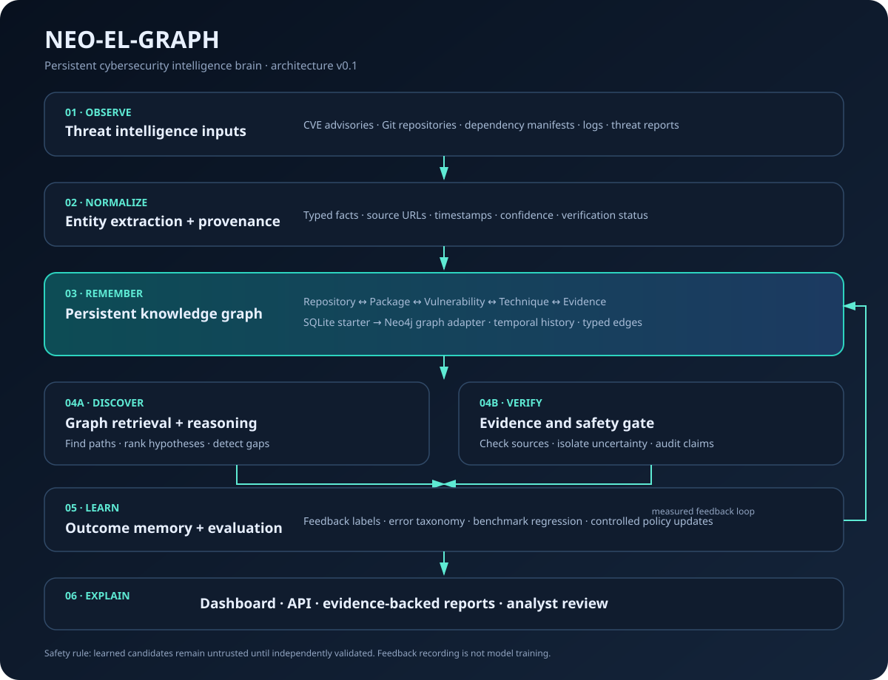

# Neo-EL-Graph

**An evidence-aware cybersecurity intelligence brain built around persistent knowledge, graph reasoning, and controlled learning.**

Neo-EL-Graph is designed to connect threat intelligence, repositories, dependencies, vulnerabilities, and investigation evidence in a persistent graph. Rather than treating every task as a disposable agent conversation, the system records knowledge, exposes relationships, tracks investigation outcomes, and creates a foundation for measurable improvement.

> **Current status:** foundational prototype. The API, SQLite-backed graph store, investigation workflow, feedback records, tests, and interactive dashboard are included. Live threat feeds, Neo4j, LLM reasoning, and automatic policy improvement are planned integrations, not implemented capabilities yet.

## Visual architecture

The interactive dashboard is served by the FastAPI app at the root URL. It shows graph entities and relationships, system counts, brain layers, and investigation output.

## Brain layers

1. **Signal ingestion** — structured threat intelligence and repository/dependency facts.
2. **Normalization and provenance** — typed entities, relationships, source URLs, confidence, and verification state.
3. **Persistent knowledge graph** — local SQLite graph adapter with a clear path to a Neo4j adapter.
4. **Retrieval and reasoning** — query-to-entity matching and bounded graph traversal.
5. **Evidence and safety gate** — unverified leads are excluded from investigation results by default; evidence gaps and limitations are returned.
6. **Outcome learning** — records investigator feedback and tracks evaluation readiness. It does not silently retrain a model or modify its own code.
7. **Interface and observability** — FastAPI endpoints and a responsive graph dashboard.

Detailed design: [Brain architecture](docs/brain-architecture.md).

## Quick start

Python 3.11+ is recommended.

    python -m venv .venv
    # Windows PowerShell
    .venv\Scripts\Activate.ps1
    # macOS/Linux
    source .venv/bin/activate
    pip install -r requirements.txt
    uvicorn app.main:app --reload

Open:
- Dashboard: http://127.0.0.1:8000
- Interactive API docs: http://127.0.0.1:8000/docs
- Health: http://127.0.0.1:8000/health

Use **Load demo graph** on the dashboard to add synthetic, unverified sample nodes and relationships. The demo is illustrative only and is not real threat intelligence.

## API

| Method | Endpoint | Purpose |
|---|---|---|
| GET | /health | Service health |
| GET | /api/brain/overview | Counts and feedback status |
| GET | /api/graph | Graph nodes and relationships |
| POST | /api/knowledge/ingest | Upsert entities and relationships |
| POST | /api/investigate | Search knowledge and traverse connected relationships |
| POST | /api/feedback | Record an investigation verdict |
| POST | /api/demo/seed | Load a synthetic demo graph into an empty graph |

Example ingestion request:

    {
      "source": "analyst-import",
      "entities": [
        {
          "id": "repo-payment-api",
          "type": "Repository",
          "label": "payment-api",
          "properties": {"language": "Python"},
          "source_url": "https://github.com/example/payment-api",
          "confidence": 0.9,
          "verified": false
        }
      ],
      "relationships": []
    }

Set `verified: true` only when the fact has been checked against a trustworthy source. A confidence score is not a substitute for evidence.

## Test

    python -m unittest discover -s tests -v

## Planned advanced capabilities

- Neo4j graph backend and graph algorithms for multi-hop threat relationships.
- Versioned ingestion connectors for CVE/CWE/KEV advisories, SBOMs, Git repositories, and selected security telemetry.
- LLM-assisted hypothesis generation with strict structured outputs and source citations.
- Hybrid retrieval across graph, text, and optional vector indexes.
- Investigation benchmark with precision, recall, evidence correctness, false-positive rate, and p95 latency.
- Controlled learning pipeline: collect feedback, classify errors, test a candidate strategy, compare against a fixed benchmark, and promote only after regression checks.
- Background ingestion, retries, rate limits, audit logs, and deployment configuration.

## Safety and limitations

- The current investigation engine is keyword-based and traverses only data already ingested.
- It does not prove exploitability. A vulnerable dependency does not by itself prove that vulnerable code is reachable or exploitable.
- Feedback is recorded for future evaluation; it does not currently change model weights or automatically update policies.
- Demo records are synthetic and unverified.
- Do not connect production credentials or permit active security actions until authentication, authorization, rate limits, audit controls, and safety review are implemented.

## Project direction

**The differentiator is not “more agents.” It is persistent, provenance-rich knowledge plus verified reasoning and measurable improvement over time.**
